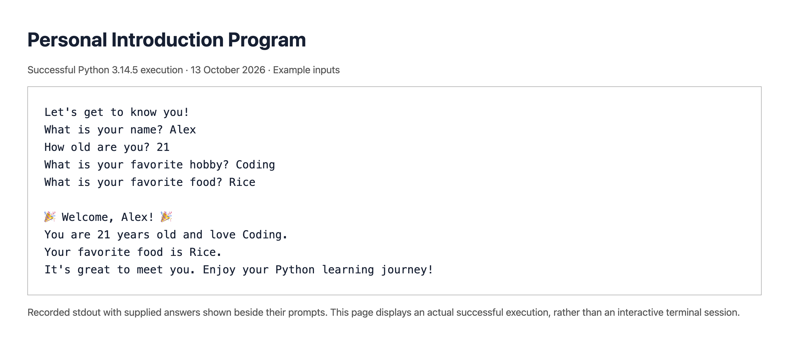

# Personal Introduction Program

Week 1 project for The Developers Arena Data Science internship.

## Overview and objectives

This command-line program asks for a name, age, favorite hobby, and favorite food, then prints a friendly welcome message. It demonstrates user input, variables, strings, and formatted output.

## Setup and running

1. Install Python 3 from https://www.python.org if it is not installed. Python is already available on the Mac used to prepare this project.
2. Download or clone the project and open its folder in Terminal.
3. Check Python with `python3 --version`.
4. Run `python3 personal_intro.py`.
5. Answer each question and press Return.

No extra packages are needed; `requirements.txt` records that fact.

## Code structure

```text
week-01/
├── personal_intro.py   # Main program
├── requirements.txt    # No external dependencies
├── README.md           # Documentation
├── hello_world.py      # First program
├── basics.py           # Variables, arithmetic, strings, lists
├── bio_data.py         # Bio-data exercise
├── step_02_input.py    # Input stage
├── step_03_welcome.py  # Welcome stage
├── test_results.txt    # Execution checks
├── sample_run.txt      # Example output
└── screenshot.png      # Screenshot of recorded execution output
```

The program runs from top to bottom. It prints an opening message, stores four answers, and prints a personalized introduction. It does not save answers to a file or send them anywhere.

## Technical details

- `input()` displays a question, waits for an answer, and returns a string.
- `name`, `age`, `hobby`, and `favorite_food` are variables that store the four answers.
- `.strip()` removes spaces from the beginning and end of each answer.
- `print()` displays messages in the terminal.
- An f-string such as `f"Welcome, {name}!"` inserts a variable's value into text.
- `\n` creates a new line.
- Lines beginning with `#` are comments explaining the code.

All four answers remain strings. Age does not need conversion to an integer because the program displays it without doing arithmetic. The program does not validate empty answers or whether the age is numeric; those are possible future improvements.

## Requirements checklist

| Portal requirement | Implementation |
| --- | --- |
| Use input() | Four input calls |
| Store answers in variables | name, age, hobby, favorite_food |
| Use print() | Opening and welcome messages |
| Ask at least three questions | Name, age, hobby, favorite food |
| Friendly output | Personalized welcome and learning encouragement |

## Example run

Example inputs are fictional, not the intern's personal details.

```text
Let's get to know you!
What is your name? Alex
How old are you? 21
What is your favorite hobby? Coding
What is your favorite food? Rice

🎉 Welcome, Alex! 🎉
You are 21 years old and love Coding.
Your favorite food is Rice.
It's great to meet you. Enjoy your Python learning journey!
```

## Testing evidence

The prepared program was executed with standard sample input, multi-word answers, and surrounding spaces. The output was checked to confirm the answers appear in the welcome message and surrounding spaces are removed. See `test_results.txt` for the recorded checks.

## Screenshot of execution evidence



The screenshot shows a browser displaying the recorded output of a successful Python run. Example answers are shown beside their prompts for readability. `sample_run.txt` contains the displayed transcript and `test_results.txt` contains execution checks. This is recorded execution evidence, not a claim that the learner personally ran an interactive terminal session.

## Learning notes

This project demonstrates how `input()` returns text and how variables store that text for later use. An f-string places those stored values into a friendly message. The answers remain strings because the program only displays them. In the practice scripts, arithmetic uses numbers and a list groups several foods; list indexing starts at zero.

## Step-by-step work

1. **Setup and first program:** Python 3.14.5 is installed. `hello_world.py` prints Hello World.
2. **Add user input:** `step_02_input.py` asks three questions and displays the answers.
3. **Welcome message:** `step_03_welcome.py` adds personalized output with f-strings.
4. **Enhance the program:** `personal_intro.py` adds a favorite-food question, trims surrounding spaces, and improves the output formatting.
5. **Finalize and test:** Comments explain the important lines. Standard inputs, multi-word answers, and surrounding spaces were checked successfully.

Additional hands-on exercises are in `basics.py` (variables, arithmetic, strings and lists) and `bio_data.py` (bio-data). The exercise details are examples to avoid publishing private personal data.

Run a practice file with, for example, `python3 basics.py`.

## Limitations

Empty answers and non-numeric ages are accepted. Input validation is a future improvement; it is not part of this week's listed technical requirements.
